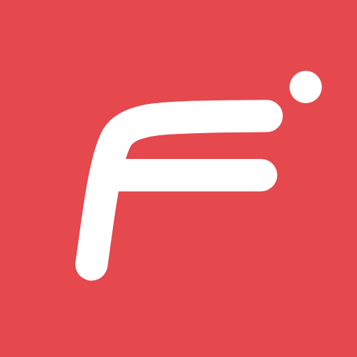

<div align="center">

<a href="https://fundapi.cn/en/"></a>

# fundapi — Official MCP Server for the Fund Data API

Let Claude Code / Codex / Cursor / any **AI Agent (MCP)** query fund data directly: NAV / quarterly holdings / managers / ratings / dividends / intraday estimate / holdings overlap / portfolio look-through / portfolio diagnostics / fund comparison / market screening — **19 tools, and the free tools need no key**.


[](https://github.com/fundapi-cn/fundapi-mcp/actions/workflows/ci.yml)


[中文](README.md) · **English**

**Works with mainstream AI Agent clients** — out of the box:


[Website](https://fundapi.cn) · [Docs](https://fundapi.cn/en/docs) · [MCP setup](https://fundapi.cn/en/mcp) · [Pricing](https://fundapi.cn/en/pricing)

[Source](https://github.com/fundapi-cn/fundapi-mcp) · [Issues](https://github.com/fundapi-cn/fundapi-mcp/issues)

</div>

---

## What it is

A **fund data MCP**: 19 fund-data tools an AI Agent can call directly. Configure it once; from then on you can ask "what are the fees on this fund and how does its 1-year return rank among peers?" and the agent fetches **real data** by itself — no code, no pasting usage instructions every time.

---

## Why use it

- **19 tools, configured once**: NAV, quarterly holdings, managers, ratings, dividends, trading rules, intraday estimate, holdings overlap, portfolio look-through, portfolio diagnostics, position changes, manager history, fund comparison, market screening
- **Free tools really need no key**: `fund_search` / `fund_profile` / `fund_screener_options` work as soon as it is installed
- **Hosted endpoint, zero install**: one URL and you are done; you can also self-host locally over stdio
- **One key, two ways to call**: MCP and HTTP share the same endpoints and quota; no separate purchase for MCP
- **Descriptions written for agents**: each tool states when to use it, how to pass parameters and what comes back
- **Documented conventions**: unit and cumulative NAV are separate fields; holdings carry `report_period`; intraday values are explicitly marked as estimates
- **Portfolio metrics are traceable**: look-through, overlap and diagnostics return `method` and `report_period`
- **Nothing to maintain**: caching, rate limiting and data refresh all happen server-side

---

## Two ways to use it

| Mode | Best for | Notes |
|---|---|---|
| **① Hosted endpoint** (recommended) | Most users | Server URL **`https://api.fundapi.cn/mcp`**, nothing to install |
| **② Local run** (this repo) | Self-hosting / intranet / reading the source | Run `mcp_fund.py` from this repo over stdio |

---

## Hosted endpoint (recommended)

> ⚠️ Use **`https://api.fundapi.cn/mcp`** — `fundapi.cn/mcp` on the website is a **setup guide page**, not the API address.

**Fastest path** — one Claude Code command (other clients below):

```bash
# Free tools (no key needed)
claude mcp add --transport http fundapi https://api.fundapi.cn/mcp

# Paid tools (holdings / managers / portfolios) need a header
claude mcp add --transport http fundapi https://api.fundapi.cn/mcp \
  --header "Authorization: Bearer cf-YOUR_KEY"

claude mcp list   # should show a connected entry
```

**Or hand it to your agent** — copy this:

> Add the fundapi MCP server for me: name `fundapi`, transport HTTP, URL `https://api.fundapi.cn/mcp`. Free tools need no key; paid tools need the header `Authorization: Bearer cf-YOUR_KEY`. When done, confirm it connects and lists 19 tools.

**Restart the client** (or reopen the session) after adding it. Then just ask, for example: "What are the fees on this fund and how does its 1-year return rank among peers?"

---

## Supported clients

| Client | Config file |
|---|---|
| Claude Desktop | `claude_desktop_config.json` |
| Claude Code | `.mcp.json` |
| Cursor | `.cursor/mcp.json` |
| VS Code | `.vscode/mcp.json` |
| Codex | `~/.codex/config.toml` (TOML) |
| OpenCode | `opencode.json` |
| Gemini CLI | `~/.gemini/settings.json` |
| Cline | `~/.cline/mcp.json` |
| Windsurf | `mcp_config.json` |
| CodeBuddy | `~/.codebuddy/.mcp.json` |
| WorkBuddy | `~/.workbuddy/mcp.json` |
| Trae | Settings → MCP → manual config |
| Kimi Code | `~/.kimi/mcp.json` |
| ZCode | `~/.zcode/cli/config.json` |
| MiMo Code | `mimocode.json` |
| Kilo Code | `kilo.jsonc` |
| Manus | Settings → Integrations → custom MCP |
| Devin | `~/.config/devin/mcp_config.json` |
| OpenClaw | `~/.openclaw/openclaw.json` |
| Hermes | `~/.hermes/config.yaml` |

**China platforms** (URL + header, nothing to install): Alibaba Cloud Bailian · Coze · Tencent Yuanqi · Tencent Cloud Agent Platform · Volcano Ark

> Full per-client configuration (keys differ, do not copy blindly): <https://fundapi.cn/en/mcp>

---

## Local run

### Requirements

- **Python ≥ 3.10**
- Dependencies: [`mcp`](https://pypi.org/project/mcp/) (**1.x and 2.x both supported**) + [`requests`](https://pypi.org/project/requests/) (≥ 2.28)

```bash
pip install -r requirements.txt
```

### Configure (Claude Desktop shown)

```json
{
  "mcpServers": {
    "fundapi": {
      "command": "python",
      "args": ["/path/to/mcp_fund.py"],
      "env": {
        "FUND_API": "https://api.fundapi.cn",
        "FUND_KEY": "cf-xxxxxxxx"
      }
    }
  }
}
```

Once configured you can ask:

```
What are the fees and size of this fund?
How much do 110022 and 009265 overlap in their top holdings?
Look through these three funds weighted 4:3:3 — which stocks do I actually own?
Screen the top 20 stock funds by 1-year return
```

→ the agent calls the tools below and uses **real data**, not memory.

### Environment variables

| Variable | Default | Notes |
|---|---|---|
| `FUND_API` | `https://api.fundapi.cn` | Base URL (usually unchanged) |
| `FUND_KEY` | empty | API key. **Empty still works** for the 3 free tools; paid tools require it ([get one](https://fundapi.cn/en/pricing), from ¥9.9) |

### Self-test

```bash
python mcp_fund.py --selftest     # calls the REST API directly, no MCP server
python tests/check_stdio.py       # local stdio handshake + tool count (expects 19)
```

---

## The 19 tools

| Tool | Purpose | No key |
|---|---|---|
| `fund_search` | Search by code, name or pinyin (use this when only a name is given) | ✅ |
| `fund_profile` | Fees, 10-period returns with peer ranking, size, asset and holder structure | ✅ |
| `fund_screener_options` | Allowed values: type tree, companies, themes, return ranges, rating agencies | ✅ |
| `fund_nav` | NAV history: unit, cumulative, daily growth, subscription status | Trial |
| `fund_rank` | Market-wide period return ranking | Trial |
| `fund_notices` | Notice index: dividends, periodic reports, manager changes | Trial |
| `fund_holdings` | Top-10 holdings, weight in NAV, shares held | Pro |
| `fund_managers` | Tenure, AUM, capability profile, returns per tenure | Pro |
| `fund_estimate` | ⭐ **Intraday estimate**: realtime and holdings-model views with per-stock contribution | Pro |
| `fund_dividends` | Dividend count, amounts and share conversion | Pro |
| `fund_trade_rule` | Trading status, T+N settlement, fee tiers, channel discounts | Pro |
| `fund_rating` | Ratings by reporting period, rising or falling | Pro |
| `fund_overlap` | Overlap of top-10 holdings across funds, weighted and combined | Institutional |
| `fund_portfolio_xray` | ⭐ **Look-through**: map a basket of funds to individual stocks and combined weights | Institutional |
| `fund_portfolio_diagnose` | ⭐ **Diagnostics**: industry exposure, look-through, position trend, total fees | Institutional |
| `fund_holding_changes` | New, dropped, increased and reduced positions | Institutional |
| `fund_manager_history` | Manager change history and returns per tenure | Institutional |
| `fund_compare` | ⭐ **Comparison**: side by side for 2–5 funds (returns, fees, managers, holdings) | Institutional |
| `fund_screener` | ⭐ **Screen**: by type, company, theme and return range | Institutional |

---

## FAQ

**Do free tools really need no key?**
No key needed. `fund_search` / `fund_profile` / `fund_screener_options` work without `FUND_KEY`, with anonymous rate limits per IP (10/min, 500/day).

**Which funds are covered? Will ETFs or QDII be added?**
Currently open-end mutual funds in mainland China, including money-market funds. ETFs, LOFs and QDII funds are planned; new products arrive as new endpoints without changing existing tool names or call patterns.

**Are MCP and HTTP different products?**
No. Same endpoints, same key, same quota; MCP is just another way to call them.

**Does it auto-renew?**
No. Access ends at expiry and you buy again manually; the API returns `403` with an expiry message.

**How fresh is the data?**
NAV updates on the evening of each trading day; holdings follow the reporting period (up to one quarter behind); intraday values are estimates, not actual NAV.

**Rate limits?**
Trial 30/min, Pro 60/min, Institutional 300/min; concurrency is capped at 8 per IP. Over the limit returns `429` with `Retry-After`.

**How fast are the endpoints?**
Most respond in 0.3–1.1s; portfolio diagnostics, multi-fund comparison and the intraday estimate take about 2–3s on the first call, then well under 1s from cache.

---

## Changelog

See [CHANGELOG.md](CHANGELOG.md).

---

## License

MIT
